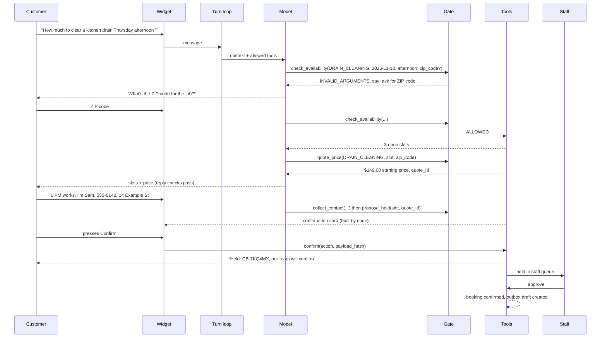
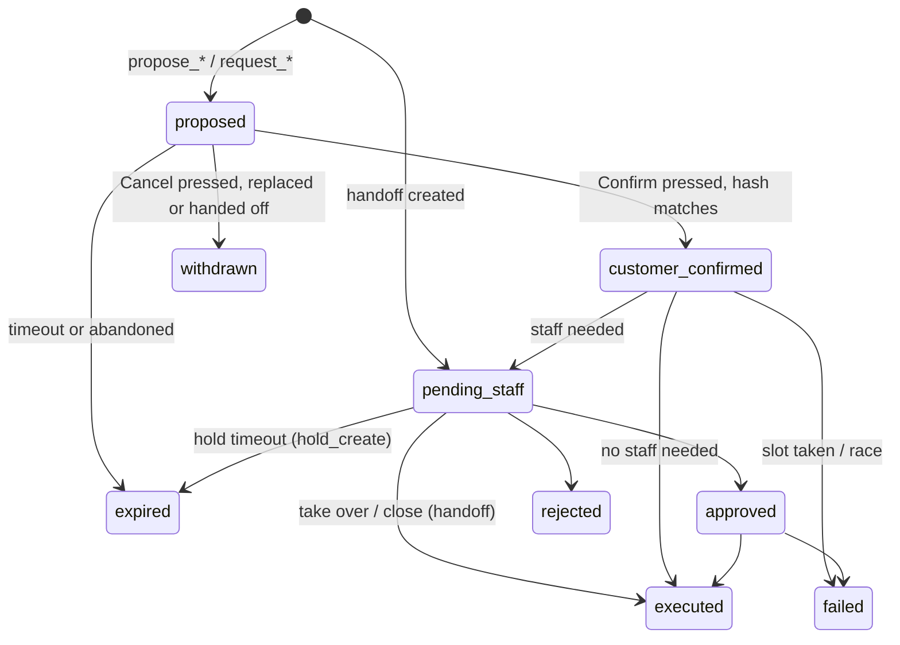

# Application Flow: Citebook

Version 0.2 (2026-11-09: review decisions in `docs/DECISIONS.md`). Statuses, tools and codes from `BACKEND_SCHEMA.md`; screens in `UI_UX_DESIGN_BRIEF.md`.

## 1. Actors

| Actor | Role |
|---|---|
| Customer | Chats on the website widget; presses Confirm or Cancel on cards |
| Assistant (model) | Talks and proposes tool calls; cannot confirm, approve or execute anything |
| Gate, tools, checks (code) | Decide, compute, execute, check |
| Staff | Confirms holds, decides late cancellations, refunds and exceptions, takes over conversations |
| Scenario runner | Plays scripted customers for evaluation through the same API |

## 2. Main flow: new booking

## 3. Flows

### 3.1 Questions only
Customer asks about services, hours, policies or prices. The model uses `list_services`, `get_policy` or `quote_price`. If `get_policy` finds nothing relevant, the reply says so and offers a person; no answer from model memory.

### 3.2 New booking (hold)
1. Service identified (the model asks if unclear; `list_services` helps).
2. ZIP code collected; a ZIP code not in `zip_areas` gets a polite refusal and the option of a person (`OUT_OF_SERVICE_AREA`). An outer-zone ZIP code adds a $40 travel line to the quote.
3. `check_availability` returns up to 6 two-hour arrival windows from technicians with the right skill; the model offers 2–3.
4. `quote_price` for the chosen slot and ZIP code. Quote-only services (for example sewer line repair) cannot be booked online; the model offers the bookable first step (camera inspection) or a person.
5. `collect_contact` (name, phone, address).
6. `propose_hold` → confirmation card → customer presses Confirm.
7. Booking `held`, slot `held`, action `pending_staff`. Customer is told "held until our team confirms" with the reference.
8. Staff approves → `confirmed`, outbox draft `booking_confirmed`. Staff rejects → `cancelled`, slot open, outbox draft `hold_declined` with the reason. Hold time (counted in office hours only) passes with no decision → `expired`, slot open, outbox draft `hold_expired`, staff queue shows it as expired.

### 3.3 Existing booking: verify
1. Customer asks about a booking.
2. Model asks for the reference and last 4 digits of the phone.
3. `verify_customer`. Success → `verified`, scoped to that one booking; contact details come from the booking. Failure → generic message; after the limit, `VERIFICATION_FAILED` handoff.

### 3.4 Reschedule
Verified → `find_booking` → `check_availability` → `quote_price` for the new slot → `propose_reschedule`. Over `max_reschedules` the gate blocks (`POLICY_BLOCKED`; model offers `request_exception` or a person).
- Current visit 24 hours or more away (`free_cancel_hours`): Confirm → executed in one transaction; old slot reopened; outbox draft `booking_rescheduled`.
- Less than 24 hours away: Confirm → `pending_staff` with `LATE_RESCHEDULE`; customer told a person will review the move and any late fee; nothing promised.

### 3.5 Cancellation
Verified → `request_cancellation`.
- Visit 24 hours or more away, or booking still `held`: Confirm → executed; outbox draft `booking_cancelled`.
- Less than 24 hours away: Confirm → `pending_staff` with `LATE_CANCELLATION`; customer told a person will review any fee; nothing promised.

### 3.6 Refund
Verified → `request_refund` → confirm submission → `pending_staff` with `REFUND`. Customer is told a person will review it. Staff approval records the decision only; money is handled outside Citebook.

### 3.7 Emergency
Screening detects gas smell, flooding, sewage backup, no water with risk, and similar. Fixed safety copy (for gas: leave the building and call the gas company's emergency number or 911 from outside), the business emergency line, `handoff` with `EMERGENCY`. No booking flow.

### 3.8 Ask for a person / staff take-over
`handoff_to_staff` any time. Conversation `handed_off`; any open card is withdrawn; assistant posts a fixed holding message; the `handoff` action waits in `pending_staff`. Staff can take over, reply in the widget and close; take-over or close moves the handoff action to `executed`.

### 3.9 Reply check failure
Draft fails → regenerated once with feedback → fails again → fixed fallback + `REPLY_CHECK_FAILED` handoff.

## 4. Action lifecycle

## 5. Screens

| Screen | Who | Purpose |
|---|---|---|
| Demo website + widget | Customer | Chat, confirmation cards, booking status messages |
| Staff queue | Staff | Pending holds, late cancellations, refunds, exceptions, handoffs, expired holds |
| Conversation detail | Staff | Transcript with tool calls, gate decisions, reply checks, actions; decide or take over |
| Calendar | Staff | Slots by technician and status |
| Outbox | Staff | Drafted notifications (never sent) |
| Settings / status | Staff | Business rules (read-only in v1 except a few), model and KB status |

## 6. Edge cases

| Case | Behavior |
|---|---|
| Customer types "yes, confirm" instead of pressing the button | Nothing executes; the assistant asks them to press Confirm on the card |
| Customer asks to change the time after the card appears | Old proposal withdrawn; new proposal and card |
| Two customers confirm the same slot | One succeeds; the other gets `failed` with fixed copy and new options |
| Quote expired before confirmation | Gate blocks `propose_hold` (`POLICY_BLOCKED`); the model re-quotes |
| Outer-area ZIP code | Quote has a $40 travel line; card shows it |
| Reschedule to a slot with a different total | New quote for the new slot; card shows old and new totals |
| Hold placed out of office hours | Hold time starts at the next office opening |
| "Next Friday" on a Thursday | Resolved by code and shown as an exact date on the card |
| Daylight saving change week | Slots generated in business time zone; tests cover it |
| Customer gives someone else's reference | Verification fails without revealing whether the reference exists |
| Customer claims to be the business owner or staff | No effect; there is no role escalation path in chat |
| Instructions in booking notes or KB documents | Treated as data; cannot unlock tools; may be flagged `SUSPICIOUS_INPUT` |
| Model invents a tool or adds arguments | `UNKNOWN_TOOL` or `INVALID_ARGUMENTS` |
| Model states a price it wasn't given | `PRICE_FROM_TOOL` fails; regenerate; fallback if needed |
| Model says "you're all booked" for a hold | `NO_FALSE_CONFIRMATION` fails |
| Customer abandons mid-proposal | Conversation `abandoned` after inactivity (from `active` or `awaiting_confirmation`); proposal expires |
| Model or KB down | Fixed fallback, `MODEL_UNAVAILABLE` or `NOT_IN_KNOWLEDGE_BASE` handoff |
| Service is quote only (for example sewer line repair) | Not bookable online; the model offers the bookable first step (camera inspection) or a person |
| Starting-price or hourly service | Quote marked as an estimate; final price confirmed on site |
| Staff never decides a hold | Hold expires; slot reopens; queue shows it as expired; outbox draft `hold_expired` for follow-up |

## 7. Data flow

| Step | Reads | Writes | Audit event |
|---|---|---|---|
| Screen | message | `messages`, `screen_flags` | `message_screened` |
| Model turn | context | none | `model_called` |
| Gate | conversation, settings | `tool_calls` | `tool_gated` |
| Tool | calendar, price book, KB, bookings | `quotes`, `customers`, `actions` | `tool_ran`, `action_proposed` |
| Confirm | `actions` | `actions`, `bookings`, `slots`, `outbox` | `action_confirmed`, `action_executed` |
| Reply checks | message, tool results | `reply_checks`, `messages` | `reply_checked` |
| Staff decision | `actions` | `staff_decisions`, `actions`, `bookings`, `slots`, `outbox` | `staff_decided` |
