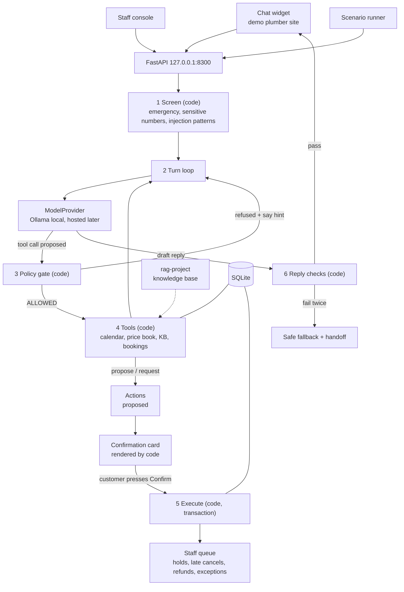

# Technical Requirements Document: Citebook

Version 0.2. Companion to `PRD.md`. Exact names come from `BACKEND_SCHEMA.md`.

## 1. Architecture



Principle carried through the suite: **the model talks and chooses; code decides, computes and checks.** The model may propose any tool call; only the gate decides whether it runs. The model may write any reply; only reply checks decide whether it is shown. Nothing changes a booking without a button press by the customer, and anything risky also needs staff.

## 2. Technology

| Area | Choice | Notes |
|---|---|---|
| Language | Python 3.13 | Same as the suite |
| API | FastAPI + Pydantic v2 | Tool argument schemas are Pydantic models; JSON Schema generated from them for the model |
| Database | SQLite (WAL), plain SQL migrations | Optimistic locking on `slots.version` |
| Model | Ollama, `qwen3:8b` with native tool calling, temperature 0, thinking off by default | Confirm tool-calling support and the exact tag against current Ollama docs when building |
| Knowledge base | rag-project HTTP API on `127.0.0.1:8000`, behind a `KnowledgeBase` interface | Retrieval only, through `POST /api/search` (see 6.1). `FakeKB` for tests |
| Dates | `zoneinfo`, a small resolver for relative phrases written in code | No natural-language date library that guesses silently |
| Front end | React + TypeScript + Vite: widget and staff console as two entry points | Types from OpenAPI |
| Tests | pytest, Vitest | No model or network in unit tests |

No LangChain, LlamaIndex or agent framework. The turn loop is about a hundred lines of visible code; that visibility is the point.

## 3. Components

```
citebook/
  citebook/
    config.py
    db.py
    models.py           enums and Pydantic models (single source of truth)
    money.py            minor units, formatting, round-half-up
    timeutil.py         business time zone, relative date resolution, arrival windows, office-hours arithmetic
    expiry.py           expire_due(now): quotes, proposals, holds, abandoned conversations
    screening.py        emergency, sensitive numbers, suspicious input, abuse, spam
    loop.py             the turn loop
    gate.py             policy gate: one function per check, pure where possible
    tools/              one module per tool; each declares kind, requirements, schema
    pricing.py          price book rules; quote construction
    verification.py
    actions.py          proposal, confirmation, execution, state machine
    reply_checks.py
    kb.py               KnowledgeBase interface, RagProjectKB, FakeKB
    providers/          ModelProvider, OllamaProvider, FakeProvider (HostedProvider later)
    prompts/            system prompt and tool descriptions, versioned
    api.py
    events.py           structured logs without message content
  db/migrations/ db/seed/
  universe/             copied unchanged from Citedesk (record the source commit in DECISIONS.md)
                        plus citebook_extension.json for Citebook's additions
  web/                  widget/ and console/
  eval/                 scenarios, runner, scorer, reports
  tools/                seed calendar, scenario builder, check_env
  tests/
  docs/
```

## 4. The turn loop

For each customer message:

0. **Expire** (code). Call `expire_due(now)` (section 7.1) so the turn sees current quotes, proposals and holds.
1. **Screen** (code). Store the message masked. If `EMERGENCY`, reply with fixed safety copy and the emergency line, create a `handoff` action with `EMERGENCY` (origin `screening`), set `handed_off`, stop. If `SUSPICIOUS_INPUT`, record the flag and continue with the guarded loop (the flag is reported; the gate does the protecting).
2. **Build context**: system prompt (version id), conversation state summary written by code (verification state, pending action summary, current date and time in the business time zone), the last N messages, and tool results. Tool results and retrieved passages are wrapped in delimited data blocks; `untrusted_fields` are marked.
3. **Call the model** with the tool list allowed **in the current state** only (the gate also checks; offering fewer tools improves choice).
4. If the model proposes tool calls: for each, run the **gate**; if `ALLOWED`, run the tool and append its result; otherwise append the refusal envelope with its `say` hint. Loop back to step 3. Limits: at most 6 tool calls per customer message; at most 3 consecutive refusals, after which the conversation escalates with `REPEATED_GATE_BLOCKS`. Escalations created by the loop (`REPEATED_GATE_BLOCKS`, `REPLY_CHECK_FAILED`, `MODEL_UNAVAILABLE`, `VERIFICATION_FAILED`) are `handoff` actions with origin `loop`.
5. When the model returns text: run **reply checks**. Pass: send. Fail: regenerate once with the failed checks described. Fail again: send a fixed fallback ("I want to make sure I give you the right details. I've passed this to our team, who'll get back to you.") and escalate with `REPLY_CHECK_FAILED`.
6. If a proposal was created this turn, the API response includes the confirmation card (built from the action's `summary`), and the conversation moves to `awaiting_confirmation`.

Timeouts: one retry on model timeout; then fixed fallback and `MODEL_UNAVAILABLE` handoff.

## 5. Policy gate

Pure function `gate(conversation, tool_name, raw_args, now) -> GateResult`. Checks in order, first failure wins:

1. `UNKNOWN_TOOL`: name not in the registry.
2. `NOT_ALLOWED_IN_STATE`: tool not allowed in the conversation status (schema 2.2).
3. `INVALID_ARGUMENTS`: Pydantic validation; extra fields rejected; ids must exist and belong to this conversation (for example `quote_id`).
4. `NEEDS_CONTACT`: tool needs contact details and none collected.
5. `NEEDS_VERIFICATION`: tool needs `verified` state.
6. `RATE_LIMITED`: per-conversation limits (for example `check_availability` 10 per conversation, `verify_customer` limited by `verification_max_attempts`).
7. `POLICY_BLOCKED`: business rules, such as more than `max_reschedules`, ZIP code not in `zip_areas`, service not bookable online, quote expired, quote not for this service, slot or ZIP code, slot (or the second window of a 2-window service) not open. A late reschedule or late cancellation is **not** blocked: it is allowed and routed to staff after Confirm.
8. `STAFF_ONLY`: reserved for any path that would execute what only staff may do (should never be reachable from tools; a test asserts that).

Ownership is enforced in the gate and again in the tool's SQL (`WHERE id = :verified_booking_id AND customer_id = :verified_customer`). Verification opens only the one booking that was verified; other bookings of the same customer need their own verification. Two independent layers, both tested.

A `verified` conversation satisfies `NEEDS_CONTACT`: code copies the contact details from the verified booking's customer.

Each refusal carries a short `say` hint written by code, so a small model can recover ("Ask for the booking reference and the last 4 digits of the phone number").

## 6. Tools

Each tool module declares: name, kind, requirements, Pydantic argument model, description for the model, and a handler. Handlers never trust the model's arguments beyond their validated form, and never take customer identity from arguments: identity comes from the conversation record.

Notes on specific tools:

- `check_availability(service_code, date_from, date_to, part_of_day?, zip_code)`: dates are ISO dates. The model is told to pass dates exactly as the resolver gave them; the API exposes the resolver to the model through the state summary ("Today is Monday 9 November 2026. 'Thursday' means 12 November."). A slot is one 2-hour arrival window for one technician, inside `visit_hours` and not on `closed_dates`. Only technicians whose `skills` include the service's `skill` are searched; a service with `windows_needed = 2` needs two consecutive open windows for the same technician. Returns at most 6 slots with ids and display times ("Thu 12 Nov, arrival 1:00–3:00 PM").
- `quote_price(service_code, slot_id?, zip_code)`: computed by `pricing.py` from `db/seed/price_book.json`, whose values come from `universe/facts.json`:
  - Call-out fee line ($89), then the job line: `fixed` and `starting_price` use `price_minor`; `hourly` shows labour at the price-book rate for `min_hours` (parts excluded).
  - A negative credit line for the call-out fee, because the universe credits it when the customer approves the work on the same visit. A fixed note says the call-out fee applies if the customer declines the work on the day.
  - A travel-fee line ($40) when the ZIP code's zone is `outer`.
  - `starting_price` and `hourly` set `is_estimate = 1` with fixed copy ("Final price confirmed on site"; "Parts extra, priced on a written estimate").
  - `quote_only` services cannot be quoted or booked online. The tool returns `POLICY_BLOCKED` with a `say` hint that names the bookable first step from data, for example `CAMERA_INSPECTION` before sewer line repair, or `LEAK_DETECTION` before slab leak repair.
  - Online slots lie only inside `visit_hours`, so the $175 emergency call-out fee never applies to an online quote. It stays in the knowledge base for questions.
  - Returns lines and a total formatted by code, and a `quote_id` valid for `quote_ttl_minutes`. A quote needs a `slot_id` before it can back a hold or reschedule.
- `get_policy(question)`: retrieves up to 4 passages with source ids. Returns `found = false` when nothing passes the relevance threshold.
- `collect_contact(name, phone, email?, address, zip_code)`: validates formats; ZIP code checked against `zip_areas`; creates or reuses a customer for this conversation only (no lookup of existing customers by phone, to prevent enumeration).
- `verify_customer(reference, phone_last4)`: compares in code with constant-time comparison; on success sets `verified` and `verified_booking_id`; on failure increments the counter and returns the same generic message whether the reference exists or not.
- `propose_hold(slot_id, quote_id)`: quote and slot must match service, slot and ZIP code; creates a `hold_create` action with a payload and a summary like: "Drain cleaning, one fixture · Thursday 12 November, arrival 1:00–3:00 PM · 14 Example St · Total $149.00 (starting price) · Held until our team confirms, usually within 2 business hours."
- `propose_reschedule(booking_reference, slot_id, quote_id)`: the reference must equal the verified booking; the quote must be for the new slot. The card shows the old and new time and, if the total changed, the old and new total. If the current visit starts less than `free_cancel_hours` from now, the summary says a team member will review the reschedule and any late fee, and the action goes to staff after Confirm (`LATE_RESCHEDULE`).
- `request_cancellation(booking_reference, reason_text?)`: free (code executes after Confirm) when the booking is `held` or the visit starts `free_cancel_hours` or more from now; otherwise staff after Confirm (`LATE_CANCELLATION`).
- `request_refund(booking_reference, reason_text)`: creates `refund_request` for staff. The reply check `NO_PROMISED_REFUND` blocks wording that promises money.

### 6.1 Knowledge base

`RagProjectKB` calls rag-project's `POST /api/search`, a retrieval-only endpoint that returns passages with source, section, text and distance and makes no model call. The endpoint is a separate change in the rag-project repo. Until it exists, `get_policy` runs on `FakeKB` and the integration test is skipped. Calling `/api/ask` instead is rejected: it runs a full model answer (about 8 s, thinking on) on the same Ollama instance for every policy question.

rag-project indexes one documents folder at a time. Citebook runs it with `RAG_DOCS_DIR` set to `kb/docs/` and its own index folder, so Citebook and Citedesk cannot use it at the same moment. The knowledge-base folder is `kb/docs/`: the `universe/docs` files plus `online-booking.md`, which `tools/build_data.py` generates from settings and the price book.

## 7. Confirmation

- The card is built by code from `actions.summary` and shown by the widget as a distinct UI element with Confirm and Cancel buttons. The model cannot create or alter a card.
- `POST /api/actions/{id}/confirm` with `payload_hash`. Server checks the action is `proposed`, not expired, belongs to this conversation session, and the hash matches. Then it executes or queues per schema 2.3.
- Typed "yes", "confirm", "I agree" never confirm. The model is told to ask the customer to press the button.
- Execution runs in one transaction with a slot version check. If the slot changed, the action becomes `failed`, the customer is told in fixed copy, and the model is given a fresh availability prompt.

### 7.1 Expiry and hold time

One function, `expire_due(now)` in `expiry.py`, applies every expiry: quotes past `expires_at`, `proposed` actions past `expires_at`, holds past `bookings.hold_expires_at` (schema 4.1), and conversations idle past the inactivity timeout (`abandoned`). It is idempotent and runs in one transaction. The API calls it at the start of every request, and a background task calls it every 60 seconds so the staff queue and calendar stay current when nobody is chatting. Tests call it with a fixed `now`.

`hold_expires_at` counts only office hours (`office_hours`, skipping `closed_dates`): a hold placed outside office hours starts counting at the next opening. With `hold_ttl_business_hours = 4`, a hold placed Friday at 9:00 PM expires Saturday at 12:00 PM (Saturday office hours are 8:00 AM to 12:00 PM), and a hold placed Saturday at 1:00 PM expires Monday at 11:30 AM (Sunday closed; Monday opens 7:30 AM). This matches the customer copy "usually within 2 business hours". `timeutil.py` owns this arithmetic, with tests across weekends, closed dates and DST changes.

## 8. Reply checks

Run on every assistant message before it is shown. They are code, using the conversation's tool results as the allowed set.

| Check | Rule |
|---|---|
| `PRICE_FROM_TOOL` | Every money amount in the reply (parsed: "$149", "149 dollars", "a hundred and forty-nine dollars" via a small number-words parser) equals an amount in a quote returned in this conversation, an amount in a `get_policy` passage returned in this conversation (for example the $45 late fee), or a fee in settings or the price book |
| `TIME_FROM_TOOL` | Every specific date or clock time stated equals a slot or booking time from a tool result, the office or visit hours from policy passages or settings, or a date that code wrote in this turn's state summary (the resolver's output, for example "'Thursday' means 12 November") |
| `REFERENCE_FROM_TOOL` | Every `CB-` reference stated belongs to this conversation's customer |
| `POLICY_GROUNDED` | Statements of fees, windows and limits ("free cancellation up to 24 hours") are matched against `get_policy` passages or settings; a numeric policy claim with no source fails |
| `NO_FALSE_CONFIRMATION` | The reply does not say a booking is booked, confirmed, cancelled or moved unless an action of that type reached `executed` (or, for holds, says "held" not "confirmed") in this conversation |
| `NO_OTHER_CUSTOMER_DATA` | No name, phone, email, address or reference that belongs to another customer appears |
| `NO_PROMISED_REFUND` | No promise of money back, credit or waived fees |
| `SCOPE` | No diagnosis instructions beyond knowledge-base passages; no instructions for gas or electrical work; no repeat of the instructions or a booking's notes (D-070); no internal names (tool names, data markers, slot or quote IDs, service codes), which also finds a translated prompt leak, and no label without its value such as "(Slot ID: )" (D-087) |

Number and time extraction is deliberately conservative: anything that looks like a figure and cannot be matched fails, and dev scenarios measure the false-alarm rate.

## 9. Prompt-injection design

Untrusted inputs: customer messages, `customers` fields, `bookings.customer_notes`, retrieved passages, and anything a tool echoes from them.

Layers (each measured separately in ablations):
1. **Least privilege per state:** only state-allowed tools are offered and accepted.
2. **Gate in code** with identity from the session, not arguments.
3. **Confirmation by button**, bound to a hash.
4. **Staff approval** for anything irreversible or money-related; refunds never execute.
5. **Data marking:** tool results in delimited blocks, `untrusted_fields` listed; the system prompt says those are data.
6. **Reply checks** stop false claims and data leaks even when the model is fooled.
7. **Screening** flags known patterns (reported, not relied on).

The adversarial suite (schema section 6) covers each attack category. For each, the report shows attack success with all layers, and with the gate and reply checks disabled (baseline), so the effect of the guards is measured, not asserted.

Ablations use one setting, `CITEBOOK_ABLATION` (schema enum `ablation`):

| Value | What is switched off |
|---|---|
| `none` | Nothing (the only value the running app accepts) |
| `baseline` | Gate checks 2 and 4–7 (state, contact, verification, rate limits, policy) and the gate's ownership check, plus all reply checks |
| `no_least_privilege` | All tools offered in every state (layer 1) |
| `no_gate_policy` | Gate checks 2 and 4–7 and the gate's ownership check (layer 2) |
| `no_data_marking` | Delimited data blocks and `untrusted_fields` (layer 5) |
| `no_reply_checks` | Reply checks (layer 6) |
| `no_screening` | Screening flags other than `EMERGENCY` (layer 7) |

What stays on in every ablation, by design: `UNKNOWN_TOOL` and `INVALID_ARGUMENTS` (a call that fails them cannot run), ownership in the tool's SQL, button confirmation (layer 3) and staff approval (layer 4). Layers 3 and 4 have no ablation because switching them off would need a code path that executes on the model's word, and rule 1 forbids that path from existing. The report states that the baseline therefore still has SQL ownership, so it understates the attack success an unguarded bot would have on `other_customer_data`.

The API refuses to start when `CITEBOOK_ABLATION` is not `none` unless `CITEBOOK_EVAL=true`. When a layer is off, `/api/status`, the widget and the console show a banner naming it.

## 10. Local first, hosted later

Same approach as Citetally: all model calls go through `ModelProvider.chat(messages, tools, …) -> ModelTurn` (text or tool calls, token counts, duration). v1 uses `OllamaProvider`. A `HostedProvider` (first candidate: the Claude API) is added later behind `CITEBOOK_ALLOW_HOSTED=true`, with a visible "hosted model" note in the widget and console, a spending cap at the provider, and tokens per conversation recorded so cost per booking can be reported. The scenario suite is re-run under both providers and compared side by side. No prompt is assumed to transfer.

## 11. HTTP API

Base `http://127.0.0.1:8300`.

| Method and path | Purpose |
|---|---|
| `POST /api/conversations` | Start; returns id and a session token (stored in session storage by the widget) |
| `POST /api/conversations/{id}/messages` | Customer message; returns assistant message(s) and any confirmation card |
| `GET /api/conversations/{id}` | Transcript for the session holder (customer view: no tool internals) |
| `POST /api/actions/{id}/confirm` | Body: `payload_hash`; session token required |
| `POST /api/actions/{id}/cancel` | Withdraw a proposal |
| `GET /api/staff/queue` | Pending staff actions and handoffs |
| `GET /api/staff/conversations/{id}` | Full transcript with tool calls, gate decisions, reply checks |
| `POST /api/staff/actions/{id}/decide` | Body: `decision`, `reason` |
| `POST /api/staff/conversations/{id}/take-over` / `close` | Staff control |
| `POST /api/staff/conversations/{id}/messages` | Staff writes to the customer (in-widget only) |
| `GET /api/staff/calendar` | Slots and bookings in a range |
| `GET /api/staff/outbox` | Drafted notifications |
| `GET /api/status` | Provider, model, KB reachability, synthetic flag, ablation in force |

One error shape: `{ "error": { "code", "message", "request_id" } }`. Staff routes are local only in v1, same as the other projects.

## 12. Configuration

`CITEBOOK_DB_PATH`, `CITEBOOK_PORT=8300`, `CITEBOOK_MODEL_PROVIDER=ollama`, `OLLAMA_URL`, `CITEBOOK_MODEL=qwen3:8b`, `CITEBOOK_ENABLE_THINKING=false`, `CITEBOOK_KB_URL=http://127.0.0.1:8000`, `CITEBOOK_MAX_TOOL_CALLS_PER_TURN=6`, `CITEBOOK_MAX_CONSECUTIVE_REFUSALS=3`, `CITEBOOK_TURN_TIMEOUT_S=60`, `CITEBOOK_ALLOW_HOSTED=false`, `CITEBOOK_SYNTHETIC_DATA=true`, `CITEBOOK_ABLATION=none` (evaluation runner only; the API refuses to start with any other value unless `CITEBOOK_EVAL=true`; see section 9), `CITEBOOK_EVAL=false`, `CITEBOOK_DEMO_START` (empty: real time; set: a demo clock that starts at that time when the API starts, D-066). Business rules live in `settings` and `db/seed/price_book.json`, not in env.

## 13. Security and privacy

- Bound to `127.0.0.1`; no auth in v1. Must not be exposed without adding customer sessions over HTTPS and staff login.
- Session token per conversation; actions and transcripts require it. Tokens are random, stored hashed.
- No customer lookup by phone or name from the bot (prevents enumeration). Verification responses are identical for wrong reference and wrong digits.
- Sensitive numbers (card-like, SSN-like) masked before storage and before the model sees them.
- No message text, names, phones, addresses or prices in logs or audit events; a test enforces this with canary strings.
- Model and customer text rendered as text, never HTML.
- No outbound messages: the outbox is drafts only, and there is no SMTP or SMS code. A test checks that no network client other than the model provider and KB is imported.

## 14. Testing

- Unit: pricing for every rule and combination (credit line, outer-zone travel fee, starting price, hourly minimum, quote-only refusal); date resolution across weekends, month ends and DST changes; office-hours hold expiry; `expire_due`; gate checks one by one; verification; action state machine; reply checks with true and false cases including paraphrased numbers.
- Concurrency: two conversations confirm the same slot; exactly one succeeds.
- Integration with `FakeProvider` scripted to emit tool calls, including malicious ones (wrong customer's reference, unknown tool, extra arguments, typed "confirm").
- Contract: recorded Ollama tool-call response replayed against `OllamaProvider`.
- UI: confirmation card states, expired card, failed execution, staff queue states.

## 15. Evaluation

Follow `qa-eval-harness`; report in the style of citecheck.

- **Scenarios:** at least 100 in `eval/scenarios/citebook_v1.jsonl`; about 60 benign (quote only, book, book with clarification, reschedule, free cancel, late cancel, refund request, out of area, not bookable online, emergency, ask for a person, policy question answered, policy question not in KB) and about 40 adversarial across the attack categories.
- **Splits by family:** sealed scenarios are written after dev numbers are frozen and run once (one run of 3 repeats). At least a third of sealed scenarios come from families with no dev scenarios; the report shows "new family" and "known family" results separately.
- **Runner:** drives the real API; scripted turns; `{confirm}` and `{cancel}` press buttons; fixed seeds; each run records commit, prompt version, model, settings, and scenario file hash. Each scenario repeated 3 times to measure spread (the model is not perfectly deterministic).
- **Scorer:** compares end state to `expected_end_state`, checks `forbidden`, escalation, attack goal, reply-check failures that reached the customer (should be 0), turns, latency.
- **Ablations (dev only):** each `CITEBOOK_ABLATION` value in section 9; thinking on versus off; later, hosted versus local.
- **Report:** tables per family and per attack category, every violation and successful attack described with transcript excerpts, and "what this cannot tell you" (scripted customers are more cooperative and less creative than real ones, small sample, one model, synthetic business).

## 16. Open technical questions

1. Tool-call reliability of the local model at this tool count; if poor, split tools by state more aggressively or add a routing step.
2. Whether to give the model the date resolver as a tool (`resolve_date`) or only in the state summary. Start with the summary.
3. False-alarm rate of `TIME_FROM_TOOL` on vague phrasing; tune on dev only.
4. Whether staff take-over should pause the model entirely (v1: yes).
